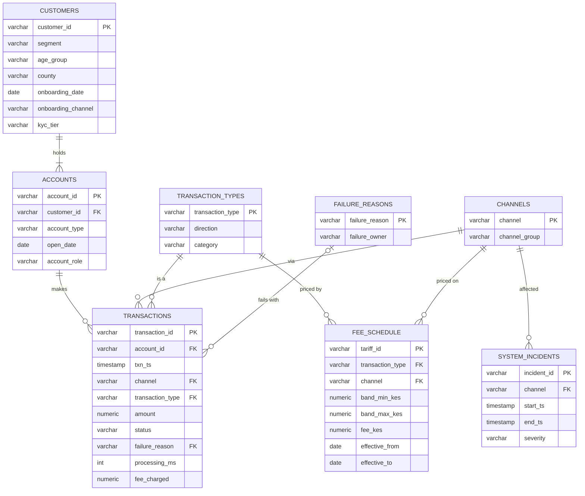
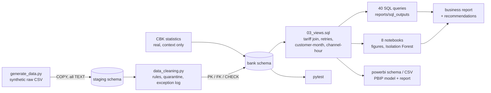
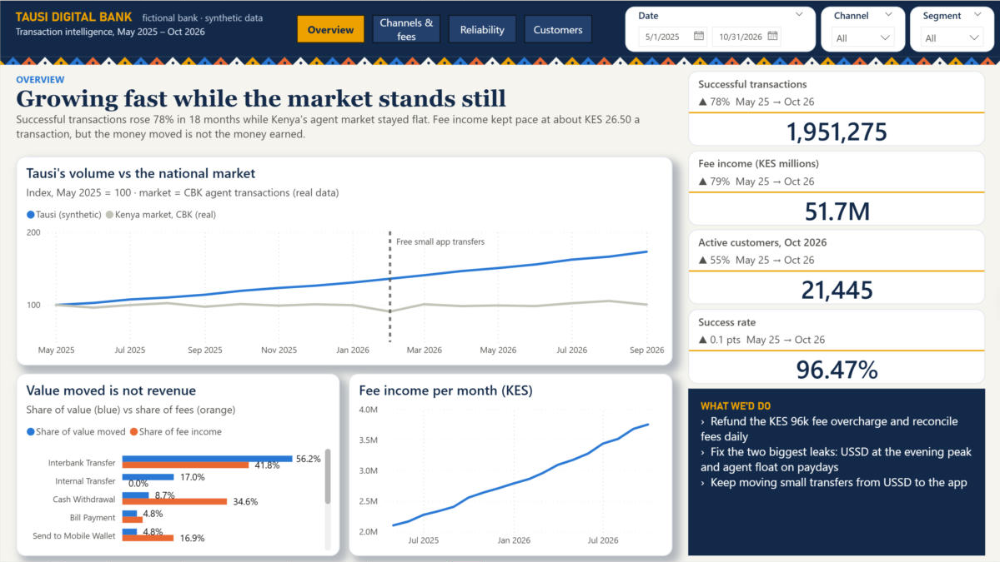
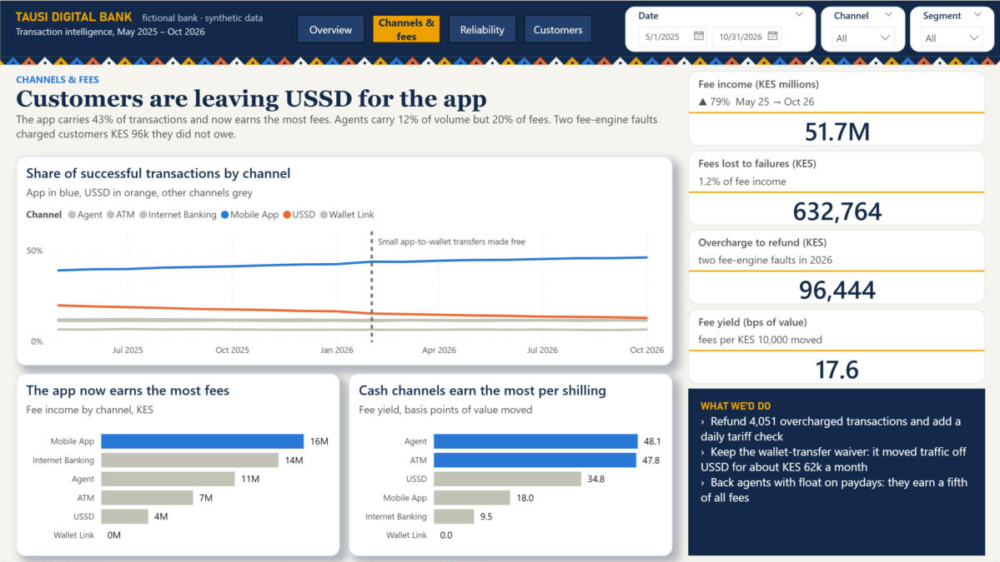
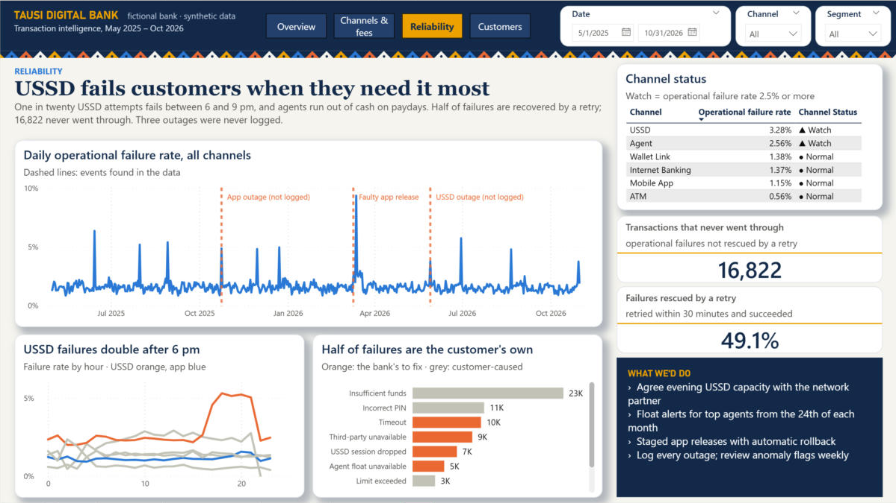
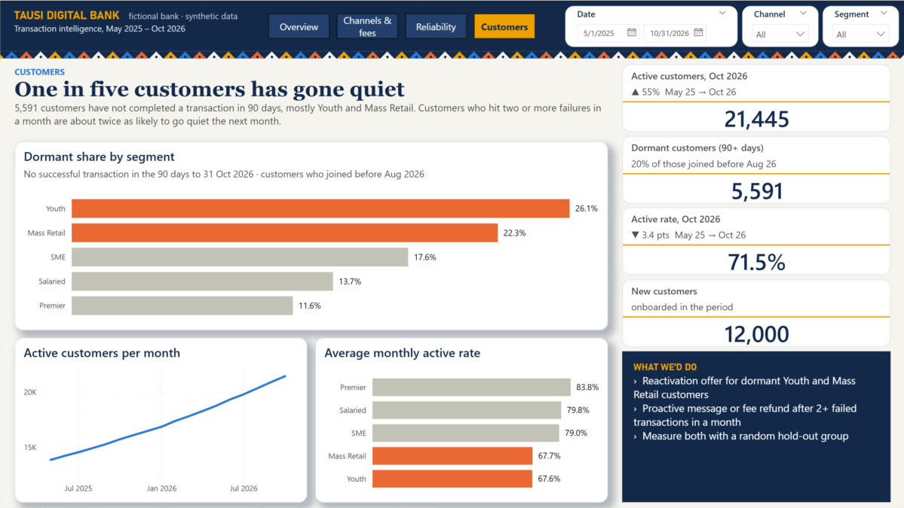
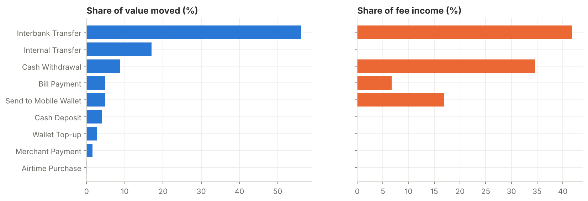
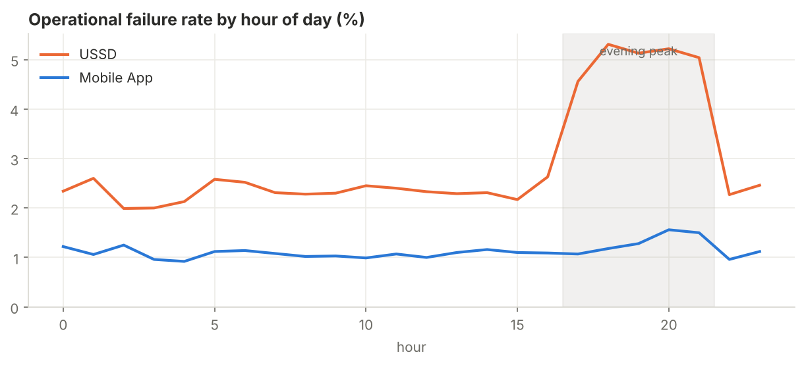

# Digital Banking Transaction Intelligence

An end-to-end analytics project for **Tausi Digital Bank**, a fictional Kenyan bank, covering transaction volume, channel performance, reliability, fee income and customer activity. It runs from a raw transaction extract to:
- a cleaned PostgreSQL model;
- 31 business SQL analyses (plus 9 data-quality queries);
- 8 Python notebooks, including an optional anomaly-detection extension;
- a 4-page Power BI dashboard;
- a management report.

> **Data disclaimer:** every customer, account and transaction here is **synthetic**. A documented, reproducible script generated it for a fictional bank. Tausi Digital Bank does not exist, and nothing in this project describes any real bank, mobile-money provider or customer. The one real dataset is the Central Bank of Kenya's published mobile-payments statistics, which are used only as a clearly labelled market trend line.

**Stack:** PostgreSQL 16 · Python (pandas, NumPy, scikit-learn, Matplotlib, Seaborn, SQLAlchemy) · Jupyter · Power BI / DAX · pytest

This project is about **operations and customers, not fraud**. There are no fraud labels and no classifier. The optional Isolation Forest looks for unusual *operational* hours (outages), not suspicious customers.

---

## 1. Executive summary
Over 18 months (May 2025 – Oct 2026) Tausi Digital Bank processed **2.02 million transaction attempts**. Of these, **1.95 million succeeded**, moving **KES 29.3bn** and earning **KES 51.7M in fees**. Monthly successful transactions grew 78%, and active customers grew from 13,900 to **21,400**.

| Question | What the data shows |
|---|---|
| Is the growth earning fees? | Yes. Fee income grew in step with volume (+79%), at a stable KES 26–27 per successful transaction. But **value is not revenue**: interbank transfers are 56% of the value moved and 42% of fees, while cash withdrawals are 9% of value and 35% of fees. |
| Which channels carry the business? | The **app** carries 43% of transactions and is gaining share (+7 points), mostly at the expense of USSD. **Internet Banking moves half the value.** **Agents** carry 12% of volume but earn 20% of fees. |
| Where do transactions fail? | 96.5% of attempts succeed. **USSD is the least reliable channel** (3.3% of attempts fail for operational reasons, and about 5% at the 18:00–21:00 evening peak). **Agents run out of cash** on paydays and weekends: 6% of agent withdrawals fail for lack of float, against 1% on other weekdays. |
| What do failures cost? | About half of operational failures are recovered by a retry within 30 minutes. The rest (**16,800 lost transactions**) cost **KES 0.63M of fees** and left **KES 251M unmoved**. Agent float shortages are the single largest item. |
| Were customers charged correctly? | No, not always. Recomputing every fee from the tariff found **two fee-engine defects**: a fee kept on transfers that had just become free (Feb 2026), and fees charged on *failed* transfers (Mar–Apr 2026). That is **KES 96k across about 4,000 transactions** to refund. |
| Did the fee waiver work? | Making small app-to-wallet transfers free (Feb 2026) moved them from USSD to the app (the app's share rose from 60% to 75%). The cost is about **KES 62k of fees a month**. |
| Who is going quiet? | **5,591 customers (19%) are dormant** (no successful transaction in 90 days), mostly Mass Retail and Youth. Customers who hit 2+ operational failures in a month were **about twice as likely to be inactive the next month** as customers with the same activity level who hit none. |
| Can outages be found without the incident log? | Yes. An Isolation Forest on channel-hours found all 11 logged incidents and **three outages that were never logged**. |

## 2. Business problem
Tausi Digital Bank's transaction volumes are growing, but management cannot see:
- which channels earn money rather than just move it;
- where and why transactions fail, and what failures cost;
- whether customers are charged correctly;
- which customers are going quiet.

The brief: *describe the transaction business by channel, diagnose reliability and fee leakage, and recommend where to act.*

## 3. Kenyan industry context
Kenyans move money through bank apps, USSD menus (`*xxx#`), agents, ATMs, internet banking and links between bank accounts and mobile-money wallets, often several of these in a week. USSD works on any phone but depends on network session capacity. Agents depend on having cash (float) on hand. National mobile-money activity is very large: the Central Bank of Kenya reports roughly 200–230 million agent cash-in/cash-out transactions a month, worth about KES 0.63–0.76 trillion, through 0.36–0.62 million agents ([CBK mobile payments](https://www.centralbank.go.ke/national-payments-system/mobile-payments/), Oct 2024 – Sep 2026). Those figures are loaded into `bank.context_cbk_mobile_payments` and used only as a market trend line.

## 4. Business objectives
1. Measure volume, value and fee income by month, channel, transaction type and segment, keeping value and revenue separate.
2. Measure reliability: success rates, failure reasons, peak-hour and payday effects, incident impact, retries and recovery.
3. Quantify fee leakage: fee income lost to failures, overcharges against the tariff, and the cost of the fee waiver.
4. Measure customer activity: active rates, dormancy, activation of new customers, and whether failures are followed by inactivity.
5. Give management a short, prioritised and measurable action list.

## 5. Dataset source
I reviewed **PaySim** (Lopez-Rojas, Elmir & Axelsson, 2016; Kaggle `ealaxi/paysim1`, CC BY-SA 4.0), the best-known public mobile-money dataset. It is itself simulated, covers only 30 days, and has no channel, status, failure reason, fee or customer fields. It was also built for fraud research, which this project deliberately avoids. Instead, [`src/generate_data.py`](src/generate_data.py) (seed 2028) simulates the bank hour by hour from May 2025 to October 2026:

| Table | Rows (clean) | Grain |
|---|---|---|
| customers | 30,000 | customer (18,000 existing + about 670 new a month) in 5 segments |
| accounts | 38,034 | account (one primary per customer) |
| transactions | 2,022,688 | one attempt, successful or failed; a retry is a new row |
| fee_schedule | 65 | tariff band: type × channel × amount band × validity period |
| system_incidents | 11 | logged outage |
| context_cbk_mobile_payments | 24 | **real** CBK monthly statistics |

The simulation includes:
- **Channels:** customer channel preferences that drift from USSD to the app.
- **Activity patterns:** weekday, hour-of-day and payday effects, plus active and dormant states.
- **Failure causes:** customer-caused failures, and operational failures with realistic triggers: USSD capacity at peak, agent float at month end, partner outages, logged and unlogged incidents, and a faulty app release.
- **Customer behaviour:** retries after failures, often on another channel. Customers who hit failures are more likely to go quiet.
- **Fees:** a versioned tariff with a February 2026 waiver, and two fee-engine defects.
- **Data quality:** 15 kinds of data-quality defects are injected and recorded in a manifest so that cleaning can be verified.

## 6. Data limitations
- The data is synthetic, so the project demonstrates method, not real-world evidence.
- Fee income is revenue, not profit: there is no cost data.
- No account balances. "Insufficient funds" is recorded, not derived.
- Retries are *inferred* (same account, type and amount within 30 minutes), not flagged at source.
- The failure-to-inactivity link is an association.
- The CBK series measures national agent cash-in/cash-out, so it is not directly comparable to a single bank's transactions.

## 7. Technology stack
| Layer | Tools |
|---|---|
| Storage & modelling | PostgreSQL 16: all-TEXT `staging` schema, a constrained `bank` schema with reference tables, a quarantine table, and three materialized views (transactions, customer-month, channel-hour) |
| Processing & analysis | Python 3.13, pandas, NumPy, scikit-learn (Isolation Forest), SQLAlchemy, psycopg2 |
| Visualisation | Matplotlib, Seaborn, Power BI (TMDL/PBIR project, DAX) |
| Quality | pytest (30 tests), SQL integrity checks, exception log, quarantine table, KPI reconciliation |

## 8. Database architecture





Design choices:
- **Reference tables drive the rules.** `failure_reasons` assigns each reason an *owner* (Customer, Operational or Unknown), which is how customer mistakes are kept out of reliability figures. `fee_schedule` is versioned with `effective_from` and `effective_to` dates.
- **Constraints enforce the business rules.** A transaction has a failure reason if and only if it failed (`CHECK ((status = 'Failed') = (failure_reason IS NOT NULL))`), and each customer has exactly one primary account (a partial unique index).
- **Quarantined rows are kept.** They go to `bank.quarantined_transactions` with a reason instead of being deleted.
- **`bank.mv_transactions` is the semantic layer.** It joins every attempt to the tariff in force on its date, so expected fee and fee variance come for free, and uses `LEAD()` to infer whether a failure was retried and recovered.

## 9. Analytical methodology
Profile → clean (fix only what is certain, quarantine what would be a guess, log everything) → validate → **define metrics once** → analyse with SQL → investigate with Python → communicate.

| Metric | Definition |
|---|---|
| Success rate | successful attempts ÷ all attempts (a retry is a new attempt) |
| Operational failure rate | failures owned by the bank or a partner ÷ attempts (customer-caused failures reported separately) |
| Transaction value | KES moved by successful attempts. **Not revenue.** |
| Fee income | fees charged on successful attempts |
| Fee yield | fee income ÷ value, in basis points |
| Retry / recovered | next attempt on the same account with the same type and amount within 30 minutes / that retry succeeded |
| Fee income lost to failures | tariff fee of operational failures that were not recovered |
| Overcharge | fee charged − tariff fee (0 for failed attempts) |
| Active customer | at least one successful transaction in the month |
| Dormant | no successful transaction in the 90 days to 31 Oct 2026 |

Full details: [`reports/methodology.md`](reports/methodology.md).

## 10. SQL analysis
There are 40 named queries in `sql/`, organised by purpose:
- `02_data_quality_checks` (9)
- `04_volume_and_channels` (8)
- `05_reliability` (8)
- `06_fees` (6)
- `07_customer_activity` (9)

They use joins (including range joins to a versioned tariff), CTEs, `CASE WHEN`, conditional aggregation (`FILTER`), window functions (`LEAD`, `LAG`, `RANK`, `NTILE`, `FIRST_VALUE`, running sums, moving averages), `ROLLUP`, percentiles, `generate_series` and date logic.

`python -m src.run_sql` runs them all and saves each result to `reports/sql_outputs/`. The [SQL query guide](reports/sql_query_guide.md) explains each query's purpose and result.

## 11. Python analysis
| Notebook | Content |
|---|---|
| [01_transaction_data_understanding](notebooks/01_transaction_data_understanding.ipynb) | tables and grain, definitions, one customer traced end to end, the tariff |
| [02_data_quality_and_cleaning](notebooks/02_data_quality_and_cleaning.ipynb) | profiling, rules, quarantine, exception log reconciled against the injection manifest |
| [03_volume_and_channel_analysis](notebooks/03_volume_and_channel_analysis.ipynb) | growth, channel mix shift, hour × weekday heatmap, payday effect, value vs fees |
| [04_reliability_and_failures](notebooks/04_reliability_and_failures.ipynb) | failures by owner and channel, USSD peak, agent float, retries, incidents, app release |
| [05_fee_income_analysis](notebooks/05_fee_income_analysis.ipynb) | fee trends, fees lost to failures, billing exceptions, waiver impact |
| [06_customer_activity_and_segments](notebooks/06_customer_activity_and_segments.ipynb) | activity and dormancy, activation, failures vs next-month activity, concentration, CBK context |
| [07_anomaly_investigation](notebooks/07_anomaly_investigation.ipynb) | **optional** Isolation Forest on channel-hours, compared with the incident log |
| [08_business_recommendations](notebooks/08_business_recommendations.ipynb) | sizing and recommendations |

Reusable code is in `src/`:
- `data_loader.py`: env-var connection and COPY loader.
- `data_cleaning.py`: the cleaning rules.
- `analysis.py`: metric functions, plus Python mirrors of the tariff and retry logic, tested against SQL.
- `pipeline.py`, `run_sql.py` and `export_powerbi.py`.

**Anomaly extension.** Each channel-hour gets three features: volume against its usual level for that weekday and hour, smoothed operational failure rate, and p95 latency against the channel's median. The features are standardised within each channel and scored with an Isolation Forest (contamination 0.3%). Flagged hours are grouped into episodes and only afterwards compared with the incident log.
- All 11 logged incidents were found.
- Three high-failure episodes are **missing from the log**. Because the data is synthetic, I could confirm these are exactly the three outages the generator left unlogged.
- The model is weaker on slow-burning problems: the March 2026 app release barely moves any single hour, so it is caught by daily monitoring (notebook 04) instead.

## 12. Power BI dashboard
The dashboard is built as a **Power BI project** ([`powerbi/TausiDigitalBank.pbip`](powerbi/)). The TMDL model and PBIR report are text files generated by `scripts/build_pbip.py`, then loaded and refreshed in Power BI Desktop.

The model has 10 tables:
- a marked date table and channel, segment and customer dimensions;
- daily facts for transactions, failures and channel-hours;
- the customer-month grid and the market-context table.

It has 10 single-direction relationships and 50 DAX measures (32 business measures plus 18 for KPI deltas, status labels and highlight colours). The card values match `powerbi/kpi_reconciliation.csv` exactly. Model and measures: [`powerbi/README.md`](powerbi/README.md).






## 13. Key findings
1. **Growth:** monthly successful transactions +78% and fee income +79% (May 2025 → Oct 2026). Active customers grew from 13,900 to 21,400, while the active rate eased from 75% to 72% as the base grew.
2. **Value ≠ revenue:** interbank transfers are 56% of value and 42% of fees. Cash withdrawals are 9% of value but 35% of fees. Internal transfers move 17% of value and earn nothing.
3. **Channel shift:** the app went from 39% to 46% of transactions and USSD from 20% to 13%. The app is now the largest fee earner (KES 16.1M), ahead of Internet Banking (KES 14.1M) and agents (KES 10.6M).
4. **USSD reliability:** 3.3% of USSD attempts fail for operational reasons, rising to about 5% between 18:00 and 21:00. USSD has the lowest success rate (94.2%).
5. **Agent float:** 6% of agent withdrawals fail for lack of cash on payday days and weekends (1% on ordinary weekdays). This is the largest source of lost fee income (KES 0.21M).
6. **Retries:** about 53% of operational failures are retried within 30 minutes and 49% are recovered. During outages recovery drops to 19%.
7. **Incidents:** logged incidents push the affected channel's failure rate to 41–62% for 2–8 hours. The March 2026 app release raised app timeouts about sevenfold for ten days and was never logged as an incident.
8. **Billing defects:** KES 96,444 overcharged across 4,051 transactions in two fee-engine defects.
9. **Waiver:** the free small app-to-wallet transfers moved 15 points of share from USSD to the app, at a cost of about KES 62k a month.
10. **Dormancy and experience:** 19% of customers are dormant (Youth 24%, Premier 11%). Within the same activity band, customers with 2+ operational failures were about twice as likely to be inactive the next month.
11. **Concentration:** the top 10% of customers move 71% of value but pay 47% of fees. SME and Premier customers are 18% of the base and pay 54% of fees.
12. **Market context:** the bank's volume grew about 73% by September 2026, while national agent transactions (CBK) were broadly flat.




## 14. Business recommendations
1. **Agent float programme for paydays and weekends:** float alerts and liquidity support for high-volume agents from the 24th of each month and on Fridays.
2. **USSD peak capacity:** agree evening session capacity with the network partner and keep moving small transfers to the app.
3. **Refund the overcharges and reconcile fees daily** against the tariff.
4. **App release controls:** staged roll-out with automatic rollback when timeouts exceed twice their normal level.
5. **Log every outage**, with anomaly monitoring as a safety net for what is missed.
6. **Reactivate dormant customers and follow up on bad experiences:** contact customers who hit 2+ operational failures in a month.

Owners, evidence and success measures are in [`reports/recommendations.md`](reports/recommendations.md). The full write-up is [`reports/business_report.md`](reports/business_report.md).

## 15. Limitations
See §6. The most important:
- The findings come from simulated data.
- The failure-to-inactivity and waiver results are observational associations.
- Fee income is not profit.

## 16. Future improvements
- Balance data, to separate genuine insufficient funds from timing problems.
- A source-system retry flag or session ID, instead of inferring retries.
- Agent-level float data to forecast cash needs per agent.
- An A/B test of fee changes, and a hold-out group for reactivation offers.
- Real-time reliability monitoring: the anomaly model on a streaming feed, with operations feedback to tune the threshold.

## 17. What I learned
- **Value is not revenue.** My first draft ranked channels by value moved, which put Internet Banking far ahead. Adding fee income showed that agents and the app earn most per transaction. Every page of the dashboard now labels the two separately.
- **A failure is not always the bank's fault.** Half of all failed attempts are insufficient funds or a wrong PIN. Mixing them into a "failure rate" would have hidden the real reliability problems. A small `failure_reasons` reference table with an owner column fixed this at the source.
- **Recomputing the fee is the audit.** Joining every transaction to the tariff in force on its date turned "fee income" into "fee income vs what we should have charged". That exposed two fee-engine defects that no data-quality rule would catch, because the data was internally consistent, just wrong.
- **Some "bad data" must not be cleaned.** I deliberately kept the wrong fees as recorded, because the difference is the finding. Cleaning them would have erased the refund liability.
- **Compare like with like.** Customers who hit failures looked *more* loyal, because busy customers hit more failures. Comparing within activity bands showed the opposite.
- **Anomaly detection and trend monitoring do different jobs.** The Isolation Forest found sudden outages, including unlogged ones, but not a slow ten-day degradation. A daily trend chart caught that easily.

## 18. Reproduction
Requirements: Python 3.10+, PostgreSQL 14+ (tested on 16), and Power BI Desktop for the dashboard.

```bash
git clone https://github.com/M-Linet/digital-banking-transaction-intelligence.git
cd digital-banking-transaction-intelligence
python -m venv .venv && .venv\Scripts\activate        # Windows  (macOS/Linux: source .venv/bin/activate)
pip install -r requirements.txt
copy .env.example .env                                 # then set PGPASSWORD (macOS/Linux: cp)
python scripts/run_all.py                              # data → DB → SQL → notebooks → Power BI extract + project → tests
```
Then open `powerbi/TausiDigitalBank.pbip` in Power BI Desktop and click **Refresh**. The generated data (about 280 MB) is git-ignored and is rebuilt deterministically from the seed. The CBK context file in `data/context/` is small, real and committed.

---
*Interview preparation: [`reports/interview_questions.md`](reports/interview_questions.md).*
