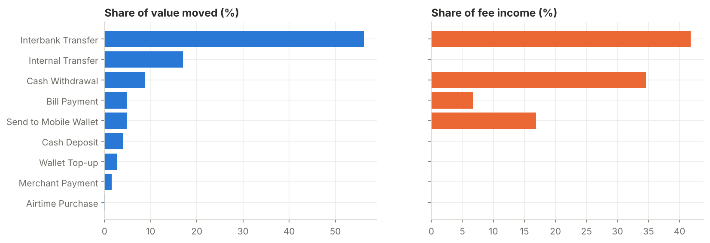
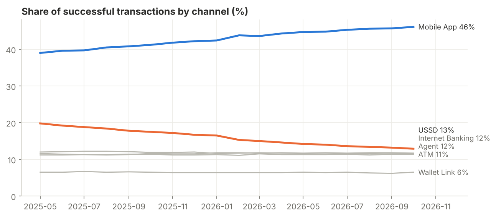
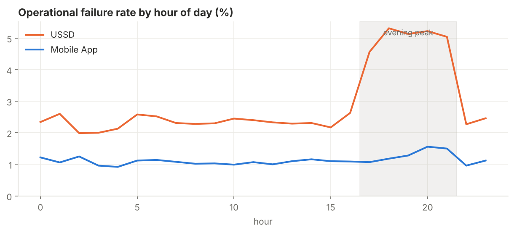
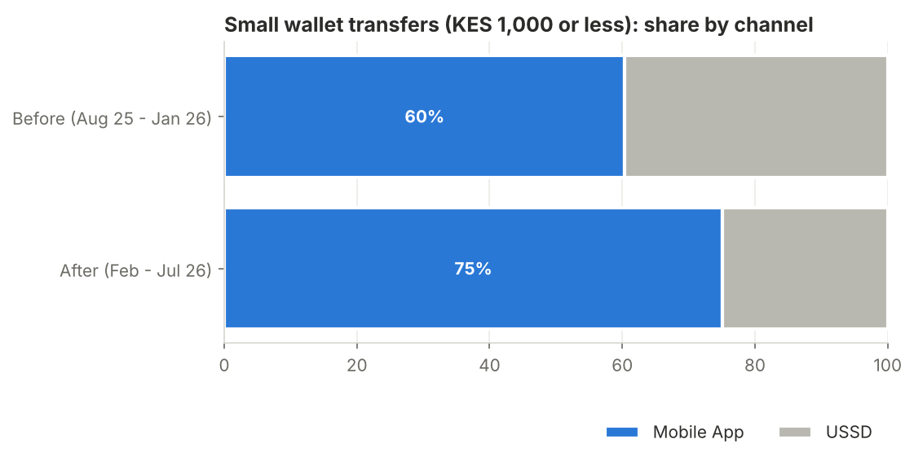
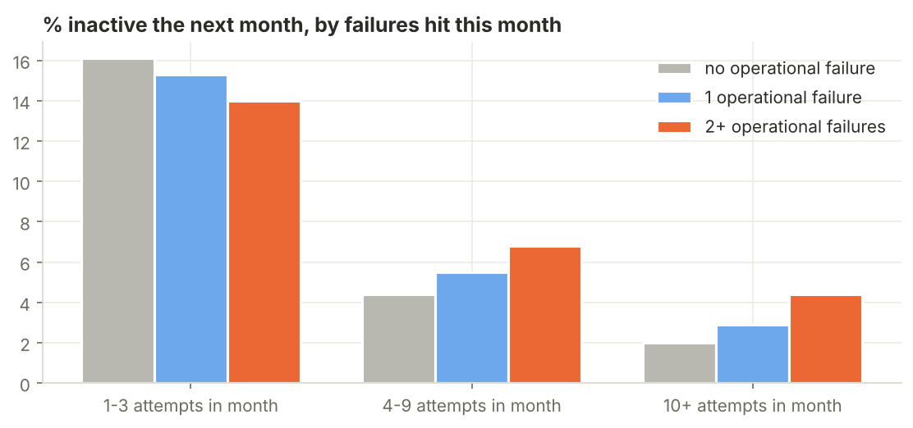
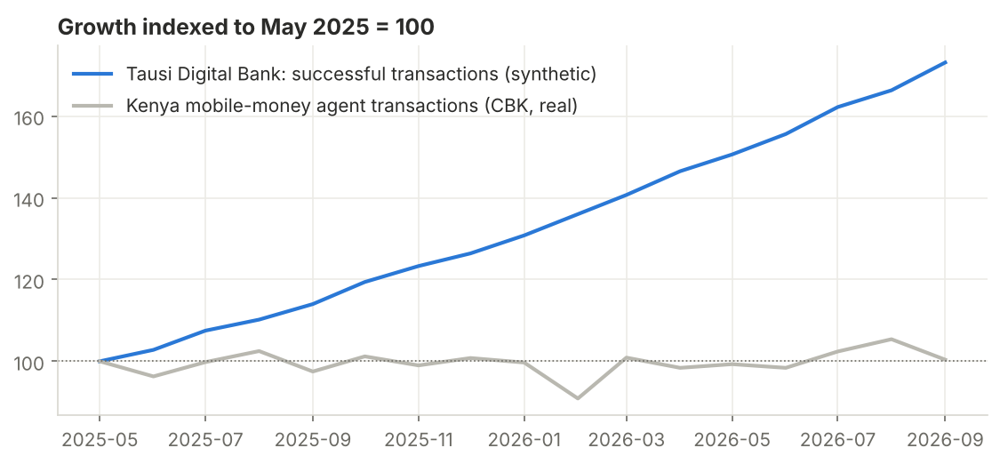

# Tausi Digital Bank: transaction, channel and fee review
*Prepared for the Head of Digital Channels and the Chief Operating Officer · data May 2025 – October 2026 · synthetic data, fictional bank*

## 1. Summary
In 18 months the bank processed **2.02 million transaction attempts**. **1.95 million succeeded (96.5%)**, moving **KES 29.3bn** and earning **KES 51.7M in fees**. Monthly volume grew 78% and active customers grew from 13,900 to 21,400.

The business is growing well, but there are four problems:
- **Two channels fail customers at predictable times.** USSD fails about 5% of attempts in the evening peak, and agents fail 6% of cash withdrawals on paydays and weekends because they run out of float.
- **Failures leak money.** Half of operational failures are recovered by a retry. The other 16,800 cost KES 0.63M of fees and left KES 251M unmoved.
- **The fee engine overcharged customers.** Two defects charged KES 96k against the tariff across 4,051 transactions. These need refunding.
- **19% of customers are dormant.** Customers who hit repeated failures are about twice as likely to go quiet the next month.

## 2. Growth, and why value is not revenue
| | May 2025 | Oct 2026 | Change |
|---|---|---|---|
| Successful transactions | 79,845 | 142,328 | +78% |
| Value moved (KES) | 1.17bn | 2.17bn | +85% |
| Fee income (KES) | 2.10M | 3.75M | +79% |
| Active customers | 13,866 | 21,445 | +55% |
| Active rate | 74.9% | 71.5% | −3.4 pts |

Fee per successful transaction is steady at KES 26–27, and fee yield at about 17–18 basis points of value. **What moves money is not what earns it:**

| Transaction type | Share of value | Share of fees |
|---|---|---|
| Interbank transfer | 56% | 42% |
| Internal transfer | 17% | 0% |
| Cash withdrawal | 9% | 35% |
| Send to mobile wallet | 5% | 17% |
| Bill payment | 5% | 7% |

## 3. Channels
| Channel | Share of transactions | Share of value | Fee income (KES M) | Success rate | Operational failure rate |
|---|---|---|---|---|---|
| Mobile App | 43% | 30% | 16.1 | 96.7% | 1.2% |
| USSD | 16% | 4% | 3.7 | 94.2% | 3.3% |
| Agent | 12% | 8% | 10.6 | 96.0% | 2.6% |
| Internet Banking | 12% | 51% | 14.1 | 97.1% | 1.4% |
| ATM | 11% | 5% | 7.3 | 97.5% | 0.6% |
| Wallet Link | 6% | 3% | 0.0 | 98.6% | 1.4% |

Customers are moving from USSD to the app. The app's share of transactions rose from 39% to 46% and USSD's fell from 20% to 13%. Payday days (25th – 2nd) are 35% busier than the rest of the month, and the evening (18:00–21:00) is the busiest time for digital channels.

## 4. Reliability
About half of all failed attempts are the customer's own (insufficient funds, wrong PIN, limits). The **operational** failures are the bank's problem:
- **USSD at peak.** Operational failures rise from about 2.3% in the daytime to 5.0–5.3% between 18:00 and 21:00, mostly dropped sessions.
- **Agent float.** 6.2% of agent withdrawals fail for lack of cash on payday weekdays, and 5.6–6.3% at weekends, against 1.0% on other weekdays.
- **Partners.** Third-party unavailability (interbank, billers, wallets) causes 28% of operational failures.
- **Incidents.** Eleven logged outages pushed the affected channel's failure rate to 41–62% for 2–8 hours.
- **The March 2026 app release.** App timeouts ran about seven times above normal for ten days (10–19 March) and returned to normal afterwards. It was never logged as an incident.
- **Unlogged outages.** An anomaly model working only from transaction data found all 11 logged incidents and **three outages missing from the incident log**: the app (24 Oct 2025), USSD (29 May 2026) and Internet Banking (4 Sep 2026).

**Retries.** 53% of operational failures are retried within 30 minutes and 49% are recovered. 20–30% of retries happen on a different channel, usually from USSD to the app. During outages only 19% are recovered.

## 5. Fees
**Fee income lost to failures.** 16,822 operational failures were never recovered. Had they succeeded, they would have earned **KES 633k** and moved **KES 251M**. By channel:

| Channel | Fees lost (KES) |
|---|---|
| Agent (mostly float) | 248,570 |
| Mobile App | 152,310 |
| Internet Banking | 134,125 |
| USSD | 76,342 |

**Billing exceptions.** Recomputing each fee from the tariff in force on the day:

| Issue | Period | Transactions | Overcharge (KES) |
|---|---|---|---|
| Fee charged on failed interbank transfers (app) | 2 Mar – 12 Apr 2026 | 371 | 38,910 |
| Old fee kept on newly free app wallet transfers | 1 – 14 Feb 2026 | 2,634 | 26,340 |
| Fee charged on failed wallet transfers (app) | 2 Mar – 12 Apr 2026 | 546 | 17,970 |
| Fee charged on failed wallet transfers (USSD) | 2 Mar – 12 Apr 2026 | 500 | 13,224 |
| **Total** | | **4,051** | **96,444** |

The amount is small, but charging customers for failed transactions is a conduct and complaints risk. The pattern (exact start and end dates, two specific transaction types) points to a fee-engine change, not to random errors.

**The fee waiver.** Since 1 February 2026, app transfers to mobile wallets of KES 1,000 or less are free. The app's share of these small transfers rose from 60% to 75%, moving load off USSD, the least reliable channel. The cost is about **KES 62k a month** of foregone fees (KES 562k over February – October), about 2% of fee income.

## 6. Customer activity
| Segment | Customers | Average monthly active rate | Dormant at 31 Oct |
|---|---|---|---|
| Premier | 1,839 | 83.8% | 10.7% |
| Salaried | 6,002 | 79.8% | 12.7% |
| SME | 3,632 | 79.0% | 16.2% |
| Mass Retail | 11,952 | 67.7% | 20.6% |
| Youth | 6,575 | 67.6% | 24.0% |

- **Dormancy is concentrated.** 5,591 customers (19%) have had no successful transaction for 90 days, most of them Mass Retail and Youth customers.
- **Onboarding channel makes little difference.** Dormancy is 19–21% whichever way the customer joined.
- **New customers.** About 72% of new customers are active in any month after the month they join, the same rate as the established base.

**Failures and inactivity.** Among customers making 10 or more attempts in a month, 2.0% of those who hit no operational failure were inactive the next month, against 4.4% of those who hit two or more. Among customers making 4–9 attempts, the figures are 4.4% and 6.8%. The comparison is within activity bands because busy customers both hit more failures and stay active; without the bands the pattern reverses. It is an association, not proof of cause.

**Concentration.** The top 10% of customers move 71% of value but pay 47% of fees. SME and Premier customers are 18% of the base and pay 54% of fees.

## 7. Market context (real data)
The national agent cash-in/cash-out volume published by the Central Bank of Kenya was broadly flat from May 2025 to September 2026 (index 91–105). Over the same period the bank's volume index reached 173. The two series measure different things, so this is context, not a market-share calculation.

## 8. Recommendations
Owners and measures are in [`recommendations.md`](recommendations.md).
1. Run an agent float programme for paydays and weekends.
2. Agree USSD evening capacity with the network partner and keep moving small transfers to the app.
3. Refund the KES 96k of overcharges and add a daily tariff reconciliation.
4. Add staged app releases with automatic rollback.
5. Log every outage, with anomaly monitoring as a safety net.
6. Reactivate dormant customers and follow up with customers who hit repeated failures.

## 9. Caveats
- The data is synthetic.
- Fee income is revenue, not profit.
- Retries are inferred from the data.
- The failure-to-inactivity and waiver effects are associations.
- The CBK comparison is indicative only.
